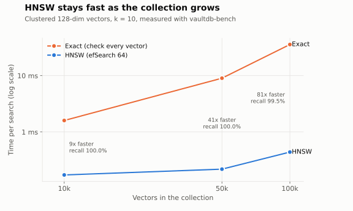
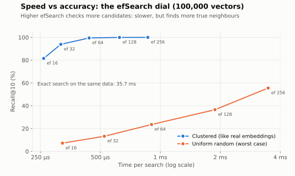

# VaultDB

A database built from scratch in Go, one layer at a time: an in-memory key-value store first, then disk persistence, indexing, a query language, a network server and vector search.

The goal is to understand how real databases (Redis, Postgres, Bitcask, LevelDB, pgvector) work on the inside by building the same ideas by hand.

## Status

**v0.8.0: Milestone 7 complete.** VaultDB finds data by meaning (vector similarity search with an HNSW index built from scratch), powers a chat-with-your-documents assistant that works with 11 AI providers, runs as a network server that many clients can use at once, and speaks SQL: tables, typed columns, primary keys, `WHERE`, `ORDER BY`, `LIMIT`, `UPDATE` and `DELETE`, all stored as ordinary keys in a B-tree and saved to a checksummed, crash-safe, self-compacting log.

## Quick start

You need [Go 1.22+](https://go.dev/dl/). On Windows you can also just double-click `run.bat`.

```bash
go run ./cmd/vaultdb
```

```
VaultDB 0.8.0. Type HELP for commands, EXIT to quit.
Loaded 0 keys from data/vaultdb.log (0 log records).
vaultdb> SET name raiyaan
OK
vaultdb> SET bio "CS student"
OK
vaultdb> EXIT
Bye.
```

Start it again and the data is still there:

```
VaultDB 0.8.0. Type HELP for commands, EXIT to quit.
Loaded 2 keys from data/vaultdb.log (2 log records).
vaultdb> GET name
"raiyaan"
```

Options:

| Flag | Meaning |
|---|---|
| `-data <path>` | Log file to use (default `data/vaultdb.log`) |
| `-memory` | Keep everything in memory and save nothing |
| `-nosync` | Skip fsync after each write: faster, but a power cut can lose the last few writes |
| `-repair` | Start even if the log is damaged, keeping everything before the damage |
| `-autocompact=false` | Never compact automatically (use the `COMPACT` command instead) |

Run the tests (the `-race` flag checks for concurrency bugs; on Windows it needs a C compiler, so drop it if it errors):

```bash
go test -race ./...
```

## Running as a server

```bash
go run ./cmd/vaultdb -serve :7379          # terminal 1: the server
go run ./cmd/vaultdb-cli                   # terminal 2: interactive client
go run ./cmd/vaultdb-cli -c "GET name"     # one command, for scripts
```

On Windows, double-click `server.bat`, then `cli.bat` (open several to see many clients at once).

```
localhost:7379> SET name raiyaan
OK
localhost:7379> GET name
"raiyaan"
```

### The protocol

Plain TCP, simple enough to use from any language:

```
client -> server   one command per line            SET name raiyaan\n
server -> client   reply length, newline, reply    2\nOK
```

Sending the length first means a reply can contain newlines (like a SQL result table) and the client still knows exactly where it ends, the same idea as Redis's bulk strings. `PING` answers `PONG`; `QUIT` closes the connection.

### How it handles many clients

- **One goroutine per client.** Goroutines are Go's lightweight threads, so hundreds of clients cost little. The store's read/write lock keeps their reads and writes safe.
- **SQL statements run one at a time.** An `INSERT` checks that a primary key is free and then writes the row. Without serialising, two clients could both see the key as free and both write it. A test runs 50 clients racing to insert the same 20 ids and checks each id is inserted exactly once.
- **Protection against bad clients:** commands over 1 MB are rejected without buffering them, silent clients are disconnected after 5 minutes, and connections are capped at 1,000.
- **Graceful shutdown:** Ctrl+C stops accepting new clients, lets running commands finish, disconnects everyone, then closes the log file cleanly.

## Vector search

Embedding models turn text into vectors (lists of numbers) where similar meanings point in similar directions. VaultDB stores them and finds the nearest ones:

```
vaultdb> VCREATE docs 3
OK, collection docs created (3 dimensions, COSINE, HNSW index)
vaultdb> VADD docs car "[1, 0, 0]" "The car broke down"
vaultdb> VADD docs vehicle "[0.9, 0.1, 0]" "My vehicle stopped working"
vaultdb> VADD docs cake "[0, 0, 1]" "I love chocolate cake"
vaultdb> VSEARCH docs "[1, 0.05, 0]" 2
1) "car"  distance 0.0012  "The car broke down"
2) "vehicle"  distance 0.0018  "My vehicle stopped working"
```

Commands: `VCREATE <coll> <dim> [COSINE|L2] [HNSW|FLAT]`, `VADD`, `VGET`, `VDEL`, `VSEARCH <coll> <vector> [k]`, `VDROP`, `VCOLLECTIONS`. Vectors are stored as keys (`vec:meta:`, `vec:item:`) in binary, 4 bytes per number, next to their original text, so they are crash-safe and survive restarts; the index is rebuilt in memory on startup.

### HNSW, built from scratch

Checking every vector (the `FLAT` index) is exact but slow. **HNSW** (Hierarchical Navigable Small World, [Malkov & Yashunin](https://arxiv.org/abs/1603.09320)), the index used by Pinecone, Qdrant, Weaviate and pgvector, is a stack of graphs:

```
layer 2:   A ----------------------- F               few nodes, long jumps
layer 1:   A ------- C ------- E --- F
layer 0:   A -- B -- C -- D -- E --- F -- G -- H     every node, short links
```

A search starts at the top, walks greedily towards the query, drops a layer, and repeats, then does a wider search on layer 0. Implementation details:

- **Random layer per node** with probability falling by 1/M per layer, so the upper layers stay sparse.
- **Neighbour selection heuristic** from the paper: a candidate is skipped if an already chosen neighbour is closer to it than the new node is, which spreads links in different directions and keeps the graph navigable.
- **Bidirectional links**, pruned back to M (2M on layer 0) with the same heuristic when a node gets too many.
- **Cosine vectors are normalised once on insert**, so each distance is a single dot product.
- **Deletes are tombstones** (deleted nodes remain as stepping stones but are never returned); the graph is rebuilt when tombstones outnumber live vectors.
- **Parallel searches** reuse "visited" sets from a pool, marked with a stamp number so they never need clearing.

### Benchmarks

Measured with the included tool (`go run ./cmd/vaultdb-bench`), 128-dimension vectors, k = 10, cosine distance, M = 16, efConstruction = 200, on a 2-core machine. Raw numbers: [`docs/benchmark.csv`](docs/benchmark.csv).



| Vectors | Exact search | HNSW (efSearch 64) | Speed-up | Recall@10 |
|---|---|---|---|---|
| 10,000 | 1.60 ms | 172 µs | 9x | 100.0% |
| 50,000 | 9.00 ms | 218 µs | 41x | 100.0% |
| 100,000 | 35.69 ms | 439 µs | 81x | 99.5% |

Exact search grows in step with the collection; HNSW barely grows, so the gap widens with size.



**efSearch is a dial between speed and accuracy.** On clustered data (which behaves like real embeddings, where topics form groups) efSearch 64 already finds 99.5% of the true neighbours at 100,000 vectors.

**The honest worst case:** on uniformly random 128-dimension vectors, recall is much lower (23.5% at efSearch 64, 55.5% at 256). In high dimensions, random points are all almost the same distance apart (the "curse of dimensionality"), so "nearest" barely means anything and no graph shortcut can find it reliably. Real embeddings are not like that, which is why approximate indexes work in practice. The benchmark includes both so the numbers are not cherry-picked.

## The playground website

`vaultdb-web` serves a website where anyone can try VaultDB in a browser: a live B-tree that splits as you insert keys, a terminal connected to a private VaultDB sandbox, an animated HNSW search, benchmark charts and a docs assistant.

```bash
go run ./cmd/vaultdb-web          # then open http://localhost:8080
```

On Windows, double-click `web.bat`.

To put it online, see [`deploy/DEPLOY.md`](deploy/DEPLOY.md): one script sets up an Oracle Cloud free-tier server with Caddy for automatic HTTPS and a hardened systemd service.

- **Every visitor gets a private, in-memory database**, deleted after 30 minutes idle, capped at 1 MB. Nobody can see anyone else's data.
- **Hardened for the public internet:** per-IP rate limits, 4 KB commands, 16 KB request bodies, server timeouts, a strict Content-Security-Policy (no inline scripts or styles, no third-party requests), `nosniff`, `frame-ancestors 'none'`, HSTS on HTTPS, and random `HttpOnly`, `SameSite=Strict` cookies. A daily cap protects any paid AI key behind the docs assistant.
- **One binary.** The front end is built into the server with `go:embed`, so deploying means copying one file.
- **Front end:** plain JavaScript with [Motion](https://motion.dev) for animation and CSS 3D transforms (a tilted B-tree card, and HNSW layers stacked in 3D space that a search drops through), bundled by esbuild into about 220 KB including self-hosted fonts. Buttons use a frosted "liquid glass" style. The B-tree drawing uses the same insert-and-split rules as the Go code. Animations respect `prefers-reduced-motion`, and glass falls back to solid with `prefers-reduced-transparency`. Source in `web/src`; rebuild with `cd web && npm install && npm run build`.

## Chat with your documents (RAG)

`vaultdb-chat` uses VaultDB as the memory of an AI assistant. It reads a folder of notes or code, stores every chunk as a vector, and answers questions using only the passages it finds, citing them:

```
INGEST (once)                          ASK (every question)
folder of .md / .txt files             "What does the report say about X?"
        |                                       |
   split into chunks                       embed the question
        |                                       |
   embed each chunk  ---> VaultDB <---  VSEARCH: nearest chunks (HNSW)
                                                |
                                        question + best chunks -> chat model
                                                |
                                        answer that cites [1], [2] ...
```

```bash
go run ./cmd/vaultdb-chat providers                         # see every option
go run ./cmd/vaultdb-chat ingest ./notes -embed ollama      # read a folder
go run ./cmd/vaultdb-chat chat -embed ollama -llm ollama    # talk to it
go run ./cmd/vaultdb-chat ask -embed ollama -llm groq "What are the main risks?"
```

On Windows: copy `vaultdb-chat.env.example` to `vaultdb-chat.env`, pick your providers and keys there, then run `chat.bat ingest <folder>` once and double-click `chat.bat`.

### Any model, your choice

Embeddings and answers are chosen separately, so you can mix them (for example free local embeddings with a fast cloud model):

| Provider | Answers | Embeddings | Needs |
|---|---|---|---|
| `local` | | built-in word hashing | nothing (instant demo) |
| `ollama` | llama3.2 | nomic-embed-text | [Ollama](https://ollama.com) on your computer, free |
| `lmstudio` | any loaded model | any loaded model | [LM Studio](https://lmstudio.ai) on your computer, free |
| `gemini` | gemini-flash-latest | gemini-embedding-001 | `GEMINI_API_KEY` (free tier) |
| `groq` | llama-3.3-70b-versatile | | `GROQ_API_KEY` (free tier) |
| `openai` | gpt-5-mini | text-embedding-3-small | `OPENAI_API_KEY` |
| `anthropic` | claude-haiku-5-5 | | `ANTHROPIC_API_KEY` |
| `mistral` | mistral-small-latest | mistral-embed | `MISTRAL_API_KEY` |
| `openrouter` | openrouter/auto | | `OPENROUTER_API_KEY` |
| `voyage` | | voyage-3.5 | `VOYAGE_API_KEY` |
| `jina` | | jina-embeddings-v3 | `JINA_API_KEY` |
| `none` | shows the matching passages only | | nothing |

Any model a provider offers can be picked with `-model` / `-embed-model`, and `-llm-url` / `-embed-url` point at any other OpenAI-compatible server.

### How it's built

- **Three adapters cover eleven providers.** Most services speak the OpenAI-compatible API, so one adapter handles OpenAI, Groq, Mistral, OpenRouter, Voyage, Jina, Ollama and LM Studio by changing only the URL. Gemini and Anthropic have their own formats and their own adapters. No SDKs: plain HTTP and JSON from the Go standard library.
- **Chunking** splits text at about 1,000 characters, preferring paragraph ends, then sentence ends, then spaces, with 150 characters of overlap so a sentence cut at a boundary is still whole in one chunk.
- **Incremental ingest.** Each file's SHA-256 is stored, so re-running only re-embeds changed files and removes chunks of deleted ones.
- **Models are never mixed.** A collection remembers which embedding model built it; vectors from two models live in unrelated spaces, so asking with a different one is refused with a clear message.
- **Grounded answers.** The model receives numbered passages and is told to answer only from them and cite them, or say it could not find the answer.
- **Keys stay private:** read from environment variables or a git-ignored `vaultdb-chat.env`, and stripped from error messages.

## SQL

```
vaultdb> CREATE TABLE students (id INT PRIMARY KEY, name TEXT, gpa FLOAT)
OK, table students created
vaultdb> INSERT INTO students VALUES (1, 'Raiyaan', 3.9), (2, 'Ali', 3.2), (3, 'Sara', 3.6)
OK, 3 rows inserted
vaultdb> SELECT name, gpa FROM students WHERE gpa > 3.5 ORDER BY gpa DESC
+-----------+-----+
| name      | gpa |
+-----------+-----+
| 'Raiyaan' | 3.9 |
| 'Sara'    | 3.6 |
+-----------+-----+
(2 rows)
```

Supported: `CREATE TABLE`, `DROP TABLE`, `SHOW TABLES`, `INSERT` (several rows at once, optional column list), `SELECT` (columns, `*`, `COUNT(*)`, `WHERE`, `ORDER BY ... ASC|DESC`, `LIMIT`), `UPDATE ... SET ... WHERE`, `DELETE ... WHERE`. Types: `INT`, `FLOAT`, `TEXT`, `BOOL`, plus `NULL`. Conditions: `= != <> < <= > >=`, `AND`, `OR`, `NOT`, `IS [NOT] NULL` and brackets.

### How SQL runs

```
"SELECT name FROM students WHERE gpa > 3.5"
        |
   lexer      -> tokens: SELECT  name  FROM  students  WHERE  gpa  >  3.5
        |
   parser     -> tree:   Select{Columns:[name], Table:students, Where: gpa > 3.5}
        |
   executor   -> reads rows from the key-value store, filters, sorts, picks columns
```

**Tables are just keys.** There is no separate table engine, the same approach used by CockroachDB and TiDB:

```
sql:schema:students                   {"columns":[{"name":"id","type":"INT","pk":true}, ...]}
sql:row:students:8000000000000001     [1,"Raiyaan",3.9]
sql:row:students:8000000000000002     [2,"Ali",3.2]
```

Because the store is a B-tree, a table's rows sit next to each other, so a full table read is one prefix walk. `WHERE id = 2` on the primary key skips the walk and does a single key lookup. Integer keys are written as 16 hex digits with the sign bit flipped, so key order matches number order, negatives included.

Rules the executor enforces: types must match the column (an `INT` is accepted in a `FLOAT` column), primary keys must be unique and not `NULL`, a multi-row `INSERT` is checked completely before any row is written, and comparing with `NULL` is never true (use `IS NULL`), as in standard SQL.

## Commands

| Command | What it does |
|---|---|
| `SET <key> <value>` | Store a value. Use `"quotes"` for values with spaces |
| `GET <key>` | Read a value, or `(nil)` if missing |
| `DEL <key>` | Delete a key. Returns 1 if it existed, 0 if not |
| `EXISTS <key>` | 1 if the key exists, 0 if not |
| `KEYS` | List every key, sorted |
| `SCAN <from> <to> [limit]` | Keys from `<from>` up to (not including) `<to>`, sorted. `""` means no start or no end |
| `PREFIX <prefix> [limit]` | Keys starting with `<prefix>`, sorted |
| `COUNT` | Number of keys |
| `CLEAR` | Delete everything |
| `INFO` | Keys, log size, live data size, garbage percentage, compactions |
| `COMPACT` | Rewrite the log with only the current data |
| `HELP` | Show the command list |
| `EXIT` | Quit |

## Architecture

```
 input line
     |
     v
 +---------+  Command{Name, Args}  +---------+  Set/Get/Delete  +---------+  append   +----------------+
 | parser  | --------------------> | engine  | ---------------> |  store  | --------> | aol (log file) |
 +---------+                       +---------+                  +---------+           +----------------+
 splits text,                      checks arguments,            B-tree in memory,     every change, in order,
 handles "quotes"                  formats the reply            RWMutex               replayed on startup
```

```
vaultdb/
  cmd/vaultdb/        entry point: the interactive shell and command-line flags
  internal/parser/    turns a line of text into a command
  internal/engine/    runs commands, returns replies (reused by the TCP server later)
  internal/store/     the data: B-tree in memory, write-ahead rule, compaction
  internal/btree/     sorted in-memory index: insert with splits, delete with borrow/merge, range walks
  internal/sql/       SQL lexer, recursive descent parser, AST, executor, result tables
  internal/vector/    vectors, cosine/L2 distance, flat index, HNSW index, collections
  cmd/vaultdb-bench/  benchmark: exact vs HNSW speed and recall at several sizes, writes CSV
  docs/               benchmark results and charts
  internal/ai/        AI providers: OpenAI-compatible, Gemini, Anthropic adapters and a local embedder
  internal/rag/       document chunking, incremental ingest, retrieval and grounded answers
  cmd/vaultdb-chat/   chat-with-your-documents command
  internal/web/       playground server: sandboxes, rate limits, security headers, JSON API
  cmd/vaultdb-web/    runs the playground website
  web/                the website: src/ (HTML, CSS, JS), dist/ (built, embedded into the binary)
  deploy/             Oracle Cloud setup script, systemd service, Caddy config, step-by-step guide
  internal/server/    TCP server: goroutine per client, length-prefixed replies, limits, graceful shutdown
  internal/client/    Go client library for the protocol
  cmd/vaultdb-cli/    command-line client (interactive or one-shot with -c)
  internal/aol/       the log file: record format, checksums, append, replay, crash recovery, atomic rewrite
```

### How persistence works

Data is never edited in place on disk. Every change is **appended** to the end of `data/vaultdb.log` as a record. On startup VaultDB reads the log from the beginning and **replays** every record, which rebuilds the in-memory map exactly as it was. Reads are served from memory and never touch the disk.

The file starts with a 9-byte header (`VAULTDB\0` plus a format version byte), followed by records. Each record is binary:

```
+------------+--------+------------+------------+-------------+-----+-------+
| hdrCRC (4) | op (1) | keyLen (4) | valLen (4) | bodyCRC (4) | key | value |
+------------+--------+------------+------------+-------------+-----+-------+
 op: 1 = SET, 2 = DEL, 3 = CLEAR          all integers big-endian
 hdrCRC  = CRC-32C of op, keyLen, valLen, bodyCRC
 bodyCRC = CRC-32C of key and value
```

Length prefixes (instead of, say, one line of text per record) mean keys and values can contain any bytes, including spaces, newlines and quotes, without escaping.

**Why two checksums?** With a single checksum over the whole record, a flipped bit in a length field would make the reader trust a wrong length before it could check anything. It could then read past the real end of the record, decide the file was cut off, and throw away every valid record after it. Verifying the small fixed-size header first means a length is only used once it is known to be correct.

### How the B-tree index works

Keys are kept in a **B-tree**, the structure behind the indexes in Postgres, MySQL and SQLite. Each node holds a sorted list of 31 to 63 keys, and a node with *n* keys has *n + 1* children holding the keys that fall between them:

```
                  [ g | p ]
                 /    |    \
        [a | c | e] [h | k] [q | t | x]
```

- **Lookup:** start at the root, binary-search inside the node, step into the right child. 100,000 keys need at most 4 levels (about 170 ns per lookup).
- **Insert:** a full node is split in two on the way down and its middle key moves up. The tree only grows at the root, so every leaf stays at the same depth.
- **Delete:** before stepping into a node with the minimum number of keys, it borrows a key from a sibling or merges with one, so no node is ever left too empty.
- **Range scans:** `SCAN` and `PREFIX` jump straight to the first matching key and walk forward in order. A hash map would have to check every key.

### How compaction works

Overwriting a key 1,000 times leaves 999 dead records in the log. VaultDB tracks how big the log *would* be with one `SET` per live key, and when the real file is at least 1 MB and more than twice that size, it compacts:

1. Write the current data to a temporary file, `vaultdb.log.compact`.
2. `fsync` the temporary file so it is fully on disk.
3. Rename it over `vaultdb.log`.

A rename within one folder is **atomic**: at every moment the path holds either the complete old log or the complete new one, never a mix. If the machine dies before step 3, the old log is untouched and the leftover temporary file is deleted on the next start.

### Design notes

- **Write-ahead rule.** A write goes to the log first and to memory second. If the disk write fails, memory is left unchanged, so the database never reports data that isn't saved.
- **fsync on every write.** `Write` only hands data to the operating system, which may keep it in RAM for a while. `fsync` forces it onto the physical disk, so once VaultDB replies `OK`, a power cut can't lose that write. This costs speed; `-nosync` trades safety for speed, which is how many databases offer it.
- **Torn-write recovery.** If the machine dies halfway through writing a record, the file ends in a partial record. Replay detects it, cuts the file back to the last complete record and starts normally.
- **Corruption is refused, not guessed.** A checksum failure in the middle of the file stops startup with an error and the exact byte offset, instead of loading wrong data. `-repair` keeps everything before the damage.
- **Format upgrades are automatic.** A log written by VaultDB 0.2 (no header, no checksums) is detected, read, and rewritten in the new format on first start.
- **Windows-safe file swapping.** Windows refuses to rename over a file that is still open, so compaction closes the log before the rename and reopens whichever file ends up at the path, even if the rename fails.
- **The store is thread-safe.** A `sync.RWMutex` lets many readers in at once but gives writers exclusive access. The write lock covers both the log append and the map update, so the log and memory always see changes in the same order.
- **The engine returns strings instead of printing.** The same engine will serve both the shell and the TCP server, so it should not know where its output goes.

## Roadmap

- [x] 1. In-memory key-value store and interactive shell
- [x] 2. Persistence: append-only log, so data survives a restart
- [x] 3. Crash recovery (checksums) and log compaction
- [x] 4. Indexing: B-tree for sorted keys, range and prefix queries
- [x] 5. A small SQL-like query language (`CREATE TABLE`, `INSERT`, `SELECT ... WHERE`, `UPDATE`, `DELETE`)
- [x] 6. TCP server so multiple clients can connect
- [x] 7. Vector search: store embeddings, nearest-neighbour queries (brute force, then HNSW), RAG chat with any AI provider
- [x] 8a. Benchmarks, playground website
- [ ] 8b. Deploy online with a custom domain, v1.0 release

## Author

Abdul Raiyaan, [GitHub](https://github.com/ABDULRAIYAAN) · [LinkedIn](https://linkedin.com/in/abdulraiyaan)
