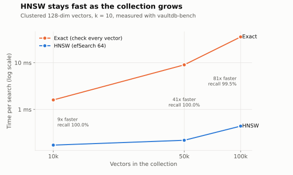
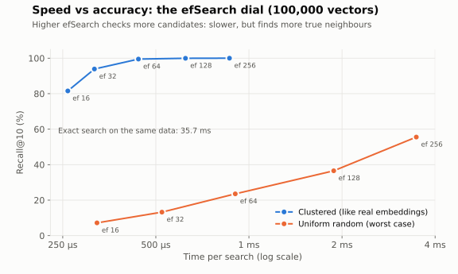

# VaultDB

A database built from scratch in Go, one layer at a time: an in-memory key-value store first, then disk persistence, indexing, a query language, a network server and vector search.

**Try it live: [vaultdb-raiyaan.vercel.app](https://vaultdb-raiyaan.vercel.app)**. The real engine, compiled to WebAssembly, runs in your browser.

The goal is to understand how real databases (Redis, Postgres, Bitcask, LevelDB, pgvector) work on the inside by building the same ideas by hand.

[](https://github.com/ABDULRAIYAAN/vaultdb/actions/workflows/test.yml)

## By the numbers

| | |
|---|---|
| Code | about 10,300 lines of Go, plus 6,900 lines of tests |
| Tests | 186 tests and 4 fuzz tests, all passing under Go's race detector |
| Test coverage | 91.8% of the database packages (`internal/`) |
| Dependencies | none: only the Go standard library |
| Key-value reads | 597 ns per lookup at 100,000 keys, 7.7x faster than SQLite, which in turn wins every SQL query test ([details](#vaultdb-vs-sqlite)) |
| Durable writes | 161 µs per write with fsync, 1.4x faster than SQLite |
| Vector search | HNSW is 81x faster than exact search at 100,000 vectors, with 99.5% recall |
| AI providers | 11, for chat-with-your-documents |

## Status

**v1.0.0.** VaultDB finds data by meaning (vector similarity search with an HNSW index built from scratch), powers a chat-with-your-documents assistant that works with 11 AI providers, runs as a network server that many clients can use at once, keeps keys with a time to live (`SET ... EX`, `EXPIRE`, `TTL`, `PERSIST`, or a set moment with `EXAT` and `EXPIREAT`) whose deadlines survive restarts, with `NX`/`XX` for set-if-missing and set-if-exists, `NX`/`XX`/`GT`/`LT` on `EXPIRE` to only add, replace, extend or shorten an expiry, `GET` to swap a value and get the old one back, and `GETDEL`/`GETEX` to read a key and delete it or change its expiry in one step, has atomic counters (`INCR`, `DECR`, `INCRBY`, `DECRBY`, and `INCRBYFLOAT` for decimals) that never lose an update when many clients count at once, string commands (`APPEND`, `STRLEN`, `GETRANGE`) that grow and slice a value without a read-then-write race, and speaks SQL: tables, typed columns, primary keys, `WHERE` (with `IN`, `LIKE` and `BETWEEN`), `ORDER BY`, `LIMIT`, `DISTINCT`, aggregates (`COUNT`, `SUM`, `AVG`, `MIN`, `MAX`, also over distinct values) with `GROUP BY` and `HAVING`, `UPDATE` and `DELETE`, secondary indexes (`CREATE INDEX`), a small query planner that turns conditions on the primary key or an indexed column into key lookups and B-tree range walks (with `EXPLAIN` to show the plan), all stored as compact binary rows under ordinary keys in a B-tree and saved to a checksummed, crash-safe, self-compacting log.

## Quick start

You need [Go 1.22+](https://go.dev/dl/). On Windows you can also just double-click `run.bat`.

```bash
go run ./cmd/vaultdb
```

```
VaultDB 1.0.0. Type HELP for commands, EXIT to quit.
Loaded 0 keys from data/vaultdb.log (0 log records).
vaultdb> SET name raiyaan
OK
vaultdb> SET bio "CS student"
OK
vaultdb> EXIT
Bye.
```

Start it again and the data is still there:

```
VaultDB 1.0.0. Type HELP for commands, EXIT to quit.
Loaded 2 keys from data/vaultdb.log (2 log records).
vaultdb> GET name
"raiyaan"
```

Options:

| Flag | Meaning |
|---|---|
| `-data <path>` | Log file to use (default `data/vaultdb.log`) |
| `-memory` | Keep everything in memory and save nothing |
| `-nosync` | Skip fsync after each write: faster, but a power cut can lose the last few writes |
| `-repair` | Start even if the log is damaged, keeping everything before the damage |
| `-autocompact=false` | Never compact automatically (use the `COMPACT` command instead) |

Run the tests (the `-race` flag checks for concurrency bugs; on Windows it needs a C compiler, so drop it if it errors):

```bash
go test -race ./...
```

## Running as a server

```bash
go run ./cmd/vaultdb -serve :7379          # terminal 1: the server
go run ./cmd/vaultdb-cli                   # terminal 2: interactive client
go run ./cmd/vaultdb-cli -c "GET name"     # one command, for scripts
```

On Windows, double-click `server.bat`, then `cli.bat` (open several to see many clients at once).

```
localhost:7379> SET name raiyaan
OK
localhost:7379> GET name
"raiyaan"
```

### The protocol

Plain TCP, simple enough to use from any language:

```
client -> server   one command per line            SET name raiyaan\n
server -> client   reply length, newline, reply    2\nOK
```

Sending the length first means a reply can contain newlines (like a SQL result table) and the client still knows exactly where it ends, the same idea as Redis's bulk strings. `PING` answers `PONG`; `QUIT` closes the connection.

### How it handles many clients

- **One goroutine per client.** Goroutines are Go's lightweight threads, so hundreds of clients cost little. The store's read/write lock keeps their reads and writes safe.
- **SQL statements run one at a time.** An `INSERT` checks that a primary key is free and then writes the row. Without serialising, two clients could both see the key as free and both write it. A test runs 50 clients racing to insert the same 20 ids and checks each id is inserted exactly once.
- **Protection against bad clients:** commands over 1 MB are rejected without buffering them, silent clients are disconnected after 5 minutes, and connections are capped at 1,000.
- **Graceful shutdown:** Ctrl+C stops accepting new clients, lets running commands finish, disconnects everyone, then closes the log file cleanly.

## Vector search

Embedding models turn text into vectors (lists of numbers) where similar meanings point in similar directions. VaultDB stores them and finds the nearest ones:

```
vaultdb> VCREATE docs 3
OK, collection docs created (3 dimensions, COSINE, HNSW index)
vaultdb> VADD docs car "[1, 0, 0]" "The car broke down"
vaultdb> VADD docs vehicle "[0.9, 0.1, 0]" "My vehicle stopped working"
vaultdb> VADD docs cake "[0, 0, 1]" "I love chocolate cake"
vaultdb> VSEARCH docs "[1, 0.05, 0]" 2
1) "car"  distance 0.0012  "The car broke down"
2) "vehicle"  distance 0.0018  "My vehicle stopped working"
```

Commands: `VCREATE <coll> <dim> [COSINE|L2] [HNSW|FLAT]`, `VADD`, `VGET`, `VDEL`, `VSEARCH <coll> <vector> [k]`, `VDROP`, `VCOLLECTIONS`. Vectors are stored as keys (`vec:meta:`, `vec:item:`) in binary, 4 bytes per number, next to their original text, so they are crash-safe and survive restarts; the index is rebuilt in memory on startup.

### HNSW, built from scratch

Checking every vector (the `FLAT` index) is exact but slow. **HNSW** (Hierarchical Navigable Small World, [Malkov & Yashunin](https://arxiv.org/abs/1603.09320)), the index used by Pinecone, Qdrant, Weaviate and pgvector, is a stack of graphs:

```
layer 2:   A ----------------------- F               few nodes, long jumps
layer 1:   A ------- C ------- E --- F
layer 0:   A -- B -- C -- D -- E --- F -- G -- H     every node, short links
```

A search starts at the top, walks greedily towards the query, drops a layer, and repeats, then does a wider search on layer 0. Implementation details:

- **Random layer per node** with probability falling by 1/M per layer, so the upper layers stay sparse.
- **Neighbour selection heuristic** from the paper: a candidate is skipped if an already chosen neighbour is closer to it than the new node is, which spreads links in different directions and keeps the graph navigable.
- **Bidirectional links**, pruned back to M (2M on layer 0) with the same heuristic when a node gets too many.
- **Cosine vectors are normalised once on insert**, so each distance is a single dot product.
- **Deletes are tombstones** (deleted nodes remain as stepping stones but are never returned); the graph is rebuilt when tombstones outnumber live vectors.
- **Parallel searches** reuse "visited" sets from a pool, marked with a stamp number so they never need clearing.

### Benchmarks

Measured with the included tool (`go run ./cmd/vaultdb-bench`), 128-dimension vectors, k = 10, cosine distance, M = 16, efConstruction = 200, on a 2-core machine. Raw numbers: [`docs/benchmark.csv`](docs/benchmark.csv).



| Vectors | Exact search | HNSW (efSearch 64) | Speed-up | Recall@10 |
|---|---|---|---|---|
| 10,000 | 1.60 ms | 172 µs | 9x | 100.0% |
| 50,000 | 9.00 ms | 218 µs | 41x | 100.0% |
| 100,000 | 35.69 ms | 439 µs | 81x | 99.5% |

Exact search grows in step with the collection; HNSW barely grows, so the gap widens with size.



**efSearch is a dial between speed and accuracy.** On clustered data (which behaves like real embeddings, where topics form groups) efSearch 64 already finds 99.5% of the true neighbours at 100,000 vectors.

**The honest worst case:** on uniformly random 128-dimension vectors, recall is much lower (23.5% at efSearch 64, 55.5% at 256). In high dimensions, random points are all almost the same distance apart (the "curse of dimensionality"), so "nearest" barely means anything and no graph shortcut can find it reliably. Real embeddings are not like that, which is why approximate indexes work in practice. The benchmark includes both so the numbers are not cherry-picked.

## VaultDB vs SQLite

The same workloads on the same machine (2-core Xeon at 2.1 GHz, Linux), against SQLite 3.54.1 in WAL mode through [go-sqlite3](https://github.com/mattn/go-sqlite3), median of 3 runs, both writing real files. Time per operation, lower is better. Raw numbers: [`docs/sqlite-comparison.csv`](docs/sqlite-comparison.csv).

| Workload | VaultDB | SQLite | VaultDB is |
|---|---|---|---|
| **Key-value** | | | |
| Write, fsync each (1,000) | 161.3 µs | 229.4 µs | 1.4x faster |
| Write, no fsync (100k) | 1.3 µs | 7.1 µs | 5.4x faster |
| Write, SQLite in one transaction (100k) | 1.3 µs | 1.9 µs | 1.5x faster |
| Point read (100k keys) | 597 ns | 4.6 µs | 7.7x faster |
| Range scan, 100 keys (x10k) | 9.2 µs | 60.2 µs | 6.5x faster |
| Reopen with 100k keys | 45.20 ms | 5.14 ms | 8.8x slower |
| **SQL** | | | |
| INSERT one row (20k) | 9.7 µs | 7.5 µs | 1.3x slower |
| SELECT by primary key (20k) | 8.6 µs | 6.4 µs | 1.3x slower |
| SELECT pk BETWEEN, 100 rows (x1k) | 212.0 µs | 46.0 µs | 4.6x slower |
| Full scan with filter, 20k rows (x20) | 38.52 ms | 957.2 µs | 40.2x slower |
| GROUP BY with aggregates, 20k rows (x20) | 47.65 ms | 4.29 ms | 11.1x slower |

What the numbers mean:

- **Key-value wins come from keeping everything in memory.** VaultDB holds every key in an in-memory B-tree and only appends to disk, so a read never touches the file. SQLite reads pages from its cache and also pays about 1.1 µs per call to cross from Go into C (measured with `SELECT 1`), which is part of every SQLite number above. The price VaultDB pays is RAM: the whole dataset must fit in memory, and SQLite has no such limit.
- **Reopening is slower** because VaultDB replays its whole log to rebuild the B-tree, while SQLite's file already is the B-tree.
- **SQL is where SQLite is far ahead.** In v1.0.0 VaultDB stored each row as JSON text and decoded every row a query touched, and it has no query planner, so scans and grouping were 11 to 40 times slower. Point queries are close because both mostly do one key lookup. Since then rows are stored in a [binary format](#binary-rows), which makes the same SQL queries 3 to 5 times faster in VaultDB's own benchmarks; the table above is from v1.0.0 and will be re-run for the next release.
- To keep it fair, SQLite's table uses `INTEGER PRIMARY KEY` (its fastest layout) and the key-value table is `WITHOUT ROWID`, one B-tree keyed by the key, the same shape as VaultDB's store. In the SQL rows, both databases parse the same query text every time, because VaultDB has no prepared statements.

Run it yourself (needs a C compiler for SQLite):

```bash
cd bench/sqlite
go run . -out ../../docs/sqlite-comparison.csv
```

It is a separate Go module, so VaultDB itself still has no dependencies.

## The playground website

The website lets anyone try VaultDB with nothing to install: a live B-tree that splits as you insert keys, a terminal running a real VaultDB, an animated HNSW search, benchmark charts and a docs assistant.

**The engine runs in the visitor's browser.** `cmd/vaultdb-wasm` compiles the same Go code (B-tree, SQL, HNSW, RAG search) to WebAssembly, and the page talks to it directly. So every visitor gets their own private database with no server behind it: nothing they type leaves their tab, there is nothing to overload, and the whole site is static files that any host can serve. It is hosted on Vercel with the settings in `vercel.json`.

```bash
cd web
npm install
npm run wasm     # compile the engine to web/src/vaultdb.wasm (needs Go)
npm run build    # bundle everything into web/dist
```

To try it locally, run `go run ./cmd/vaultdb-web` (or double-click `web.bat` on Windows) and open http://localhost:8080. That server can also run the older server-side playground and a docs assistant backed by a real AI model; [`deploy/DEPLOY.md`](deploy/DEPLOY.md) shows how to put it on your own Linux server.

- **WebAssembly build:** about 5 MB, 1.4 MB compressed, cached forever under a content-hashed name. The network code for the AI providers is left out of the browser build with a `!js` build tag, and the docs assistant searches the README and source code embedded in the binary with the local embedder, so no API key ever reaches the page.
- **Locked down:** a strict Content-Security-Policy (no inline scripts or styles, no third-party requests; `'wasm-unsafe-eval'` is the only addition, which lets the page compile WebAssembly), HSTS, `nosniff`, `frame-ancestors 'none'`, no cookies and no analytics. A size cap empties the database before it can eat the tab's memory.
- **Front end:** plain JavaScript with [Motion](https://motion.dev) for animation and CSS 3D transforms (a tilted B-tree card, and HNSW layers stacked in 3D space that a search drops through), bundled by esbuild into about 220 KB including self-hosted fonts. Buttons use a frosted "liquid glass" style. The B-tree drawing uses the same insert-and-split rules as the Go code. Animations respect `prefers-reduced-motion`, and glass falls back to solid with `prefers-reduced-transparency`.

## Chat with your documents (RAG)

`vaultdb-chat` uses VaultDB as the memory of an AI assistant. It reads a folder of notes or code, stores every chunk as a vector, and answers questions using only the passages it finds, citing them:

```
INGEST (once)                          ASK (every question)
folder of .md / .txt files             "What does the report say about X?"
        |                                       |
   split into chunks                       embed the question
        |                                       |
   embed each chunk  ---> VaultDB <---  VSEARCH: nearest chunks (HNSW)
                                                |
                                        question + best chunks -> chat model
                                                |
                                        answer that cites [1], [2] ...
```

```bash
go run ./cmd/vaultdb-chat providers                         # see every option
go run ./cmd/vaultdb-chat ingest ./notes -embed ollama      # read a folder
go run ./cmd/vaultdb-chat chat -embed ollama -llm ollama    # talk to it
go run ./cmd/vaultdb-chat ask -embed ollama -llm groq "What are the main risks?"
```

On Windows: copy `vaultdb-chat.env.example` to `vaultdb-chat.env`, pick your providers and keys there, then run `chat.bat ingest <folder>` once and double-click `chat.bat`.

### Any model, your choice

Embeddings and answers are chosen separately, so you can mix them (for example free local embeddings with a fast cloud model):

| Provider | Answers | Embeddings | Needs |
|---|---|---|---|
| `local` | | built-in word hashing | nothing (instant demo) |
| `ollama` | llama3.2 | nomic-embed-text | [Ollama](https://ollama.com) on your computer, free |
| `lmstudio` | any loaded model | any loaded model | [LM Studio](https://lmstudio.ai) on your computer, free |
| `gemini` | gemini-flash-latest | gemini-embedding-001 | `GEMINI_API_KEY` (free tier) |
| `groq` | llama-3.3-70b-versatile | | `GROQ_API_KEY` (free tier) |
| `openai` | gpt-5-mini | text-embedding-3-small | `OPENAI_API_KEY` |
| `anthropic` | claude-haiku-5-5 | | `ANTHROPIC_API_KEY` |
| `mistral` | mistral-small-latest | mistral-embed | `MISTRAL_API_KEY` |
| `openrouter` | openrouter/auto | | `OPENROUTER_API_KEY` |
| `voyage` | | voyage-3.5 | `VOYAGE_API_KEY` |
| `jina` | | jina-embeddings-v3 | `JINA_API_KEY` |
| `none` | shows the matching passages only | | nothing |

Any model a provider offers can be picked with `-model` / `-embed-model`, and `-llm-url` / `-embed-url` point at any other OpenAI-compatible server.

### How it's built

- **Three adapters cover eleven providers.** Most services speak the OpenAI-compatible API, so one adapter handles OpenAI, Groq, Mistral, OpenRouter, Voyage, Jina, Ollama and LM Studio by changing only the URL. Gemini and Anthropic have their own formats and their own adapters. No SDKs: plain HTTP and JSON from the Go standard library.
- **Chunking** splits text at about 1,000 characters, preferring paragraph ends, then sentence ends, then spaces, with 150 characters of overlap so a sentence cut at a boundary is still whole in one chunk.
- **Incremental ingest.** Each file's SHA-256 is stored, so re-running only re-embeds changed files and removes chunks of deleted ones.
- **Models are never mixed.** A collection remembers which embedding model built it; vectors from two models live in unrelated spaces, so asking with a different one is refused with a clear message.
- **Grounded answers.** The model receives numbered passages and is told to answer only from them and cite them, or say it could not find the answer.
- **Keys stay private:** read from environment variables or a git-ignored `vaultdb-chat.env`, and stripped from error messages.

## SQL

```
vaultdb> CREATE TABLE students (id INT PRIMARY KEY, name TEXT, gpa FLOAT)
OK, table students created
vaultdb> INSERT INTO students VALUES (1, 'Raiyaan', 3.9), (2, 'Ali', 3.2), (3, 'Sara', 3.6)
OK, 3 rows inserted
vaultdb> SELECT name, gpa FROM students WHERE gpa > 3.5 ORDER BY gpa DESC
+-----------+-----+
| name      | gpa |
+-----------+-----+
| 'Raiyaan' | 3.9 |
| 'Sara'    | 3.6 |
+-----------+-----+
(2 rows)
```

Supported: `CREATE TABLE`, `DROP TABLE`, `SHOW TABLES`, `CREATE INDEX`, `DROP INDEX`, `SHOW INDEXES`, `INSERT` (several rows at once, optional column list), `SELECT` (columns, `*`, `DISTINCT`, aggregates, `WHERE`, `GROUP BY`, `HAVING`, `ORDER BY ... ASC|DESC`, `LIMIT`), `UPDATE ... SET ... WHERE`, `DELETE ... WHERE`, `EXPLAIN` (for `SELECT`, `UPDATE` and `DELETE`). Types: `INT`, `FLOAT`, `TEXT`, `BOOL`, plus `NULL`. Conditions: `= != <> < <= > >=`, `AND`, `OR`, `NOT`, `IS [NOT] NULL`, `[NOT] IN (...)`, `[NOT] LIKE`, `[NOT] BETWEEN ... AND ...` and brackets.

### IN and LIKE

```
vaultdb> SELECT id, name FROM students WHERE id IN (3, 1)
+----+-----------+
| id | name      |
+----+-----------+
| 1  | 'Raiyaan' |
| 3  | 'Sara'    |
+----+-----------+
(2 rows)
vaultdb> SELECT name FROM students WHERE name LIKE '%a_'
+-----------+
| name      |
+-----------+
| 'Raiyaan' |
+-----------+
(1 row)
```

`x IN (a, b, c)` is a shorter `x = a OR x = b OR x = c`. `LIKE` matches text against a pattern: `%` is any run of characters (even none), `_` is exactly one character, and a backslash makes the next character literal (`'50\%'` matches the text `50%`). Both have a `NOT` form and work in `WHERE`, `HAVING`, `UPDATE` and `DELETE`.

- `LIKE` is case-sensitive, as in Postgres, and `_` counts characters, not bytes, so `'h_llo'` matches `'héllo'`. Both sides must be `TEXT`.
- `NULL` follows standard SQL. `x IN (1, NULL)` is true when `x` is 1 and otherwise unknown, so `x NOT IN (1, NULL)` never keeps a row. That's a famous SQL trap; use `IS NOT NULL` or leave `NULL` out of the list.
- `WHERE id IN (3, 1, 7)` on the primary key doesn't read the table: it does one key lookup per value, like `WHERE id = 3` does.

How `LIKE` runs: two pointers walk the text and the pattern. On a `%` the matcher remembers where it was; on a mismatch it jumps back there and lets the `%` swallow one more character. Only the last `%` ever needs revisiting, so a nasty pattern like `'%a%a%a%a%b'` can't make it take exponential time. A fuzz test checks it against Go's `regexp` package on random inputs.

### BETWEEN

```
vaultdb> SELECT name, gpa FROM students WHERE gpa BETWEEN 3.5 AND 4
+-----------+-----+
| name      | gpa |
+-----------+-----+
| 'Raiyaan' | 3.9 |
| 'Sara'    | 3.6 |
+-----------+-----+
(2 rows)
vaultdb> SELECT id, name FROM students WHERE id NOT BETWEEN 2 AND 3
+----+-----------+
| id | name      |
+----+-----------+
| 1  | 'Raiyaan' |
+----+-----------+
(1 row)
```

`x BETWEEN a AND b` is a shorter `x >= a AND x <= b`: both ends are included. It works on numbers, text and booleans, has a `NOT` form, and works in `WHERE`, `HAVING`, `UPDATE` and `DELETE` (`HAVING COUNT(*) BETWEEN 2 AND 5`).

- The ends must be in order: `BETWEEN 10 AND 1` matches nothing, as in Postgres and SQLite.
- `NULL` follows standard SQL, which is a little subtle here. A `NULL` value is never between anything. A `NULL` end makes the answer unknown, unless the other end already rules the value out: `9 BETWEEN NULL AND 5` is `FALSE`, because 9 is above 5 whatever the missing end is. So `id NOT BETWEEN NULL AND 5` still keeps the rows with `id > 5`.
- `WHERE id BETWEEN 100 AND 200` on an `INT` or `TEXT` primary key doesn't read the whole table: it walks just that slice of the B-tree.

### Aggregate functions

```
vaultdb> SELECT COUNT(*), AVG(gpa), MIN(gpa), MAX(name) FROM students
+-------+--------------------+----------+-----------+
| count | avg(gpa)           | min(gpa) | max(name) |
+-------+--------------------+----------+-----------+
| 3     | 3.5666666666666664 | 3.2      | 'Sara'    |
+-------+--------------------+----------+-----------+
(1 row)
```

`COUNT(*)`, `COUNT(col)`, `SUM(col)`, `AVG(col)`, `MIN(col)` and `MAX(col)` boil the rows matched by `WHERE` down to one row. They follow standard SQL: `NULL`s are skipped, `COUNT` of nothing is 0 and the others give `NULL`. `SUM` and `AVG` need an `INT` or `FLOAT` column; `MIN` and `MAX` work on any type. `SUM` of an `INT` column is exact and reports an error instead of silently wrapping around if it overflows. `SUM`, `AVG`, `MIN` and `MAX` are not reserved words, so a column can still be called `max`.

### GROUP BY

```
vaultdb> SELECT dept, COUNT(*), AVG(gpa), MAX(gpa) FROM students GROUP BY dept ORDER BY COUNT(*) DESC
+-----------+-------+----------+----------+
| dept      | count | avg(gpa) | max(gpa) |
+-----------+-------+----------+----------+
| 'cs'      | 2     | 3.75     | 3.9      |
| 'math'    | 2     | 3.3      | 3.4      |
| 'physics' | 1     | 3.1      | 3.1      |
+-----------+-------+----------+----------+
(3 rows)
```

`GROUP BY col, ...` puts rows with the same values in those columns into one group and runs the aggregates once per group. The rules match standard SQL:

- A plain column next to an aggregate must be listed in `GROUP BY` (otherwise which row's `name` would sit next to `COUNT(*)`?). The error says so.
- `NULL`s count as equal when grouping, so all rows with no `dept` form one group.
- `WHERE` filters rows before they are grouped; `LIMIT` counts groups.
- `ORDER BY` can name a `GROUP BY` column or an aggregate (`ORDER BY COUNT(*) DESC`), even one that isn't selected. Without `ORDER BY`, groups come back sorted by their `GROUP BY` values.
- `GROUP BY` with no aggregates lists each distinct value once, like `SELECT DISTINCT`.
- With no matching rows, a grouped query returns no rows, while a plain `SELECT COUNT(*)` still returns one row saying 0.

How it runs: each matching row is put in a bucket (a Go map) keyed by the JSON text of its `GROUP BY` values, then every aggregate walks the rows of each bucket. One pass to group, one per aggregate per group.

### HAVING

```
vaultdb> SELECT dept, COUNT(*), AVG(gpa) FROM students GROUP BY dept HAVING COUNT(*) >= 2 AND AVG(gpa) > 3.5
+------+-------+----------+
| dept | count | avg(gpa) |
+------+-------+----------+
| 'cs' | 2     | 3.75     |
+------+-------+----------+
(1 row)
```

`HAVING` filters groups the way `WHERE` filters rows. The order is: `WHERE` picks rows, `GROUP BY` buckets them, `HAVING` drops whole groups, then `ORDER BY` and `LIMIT` run on what's left.

- The condition can use any aggregate (selected or not) and the `GROUP BY` columns, with the same operators as `WHERE`. Any other column must sit inside an aggregate.
- Aggregates are only allowed in `HAVING`. `WHERE COUNT(*) > 1` is an error that points you to `HAVING`, because `WHERE` runs on single rows before any counting happens.
- Without `GROUP BY` the whole table is one group, so `SELECT COUNT(*) FROM t HAVING COUNT(*) > 5` returns its one row or nothing.
- `NULL` works as in `WHERE`: a group is kept only when the condition is exactly true.

How it runs: for each group, the executor swaps every aggregate in the condition for its value over that group, and every `GROUP BY` column for the group's value. What's left is an expression of plain values, which goes through the same evaluator as `WHERE`.

### DISTINCT

```
vaultdb> SELECT DISTINCT dept FROM students ORDER BY dept
+-----------+
| dept      |
+-----------+
| 'cs'      |
| 'math'    |
| 'physics' |
+-----------+
(3 rows)
vaultdb> SELECT COUNT(*), COUNT(DISTINCT dept) FROM students
+-------+----------------------+
| count | count(distinct dept) |
+-------+----------------------+
| 5     | 3                    |
+-------+----------------------+
(1 row)
```

`SELECT DISTINCT` drops result rows that are exact copies of an earlier one. Inside an aggregate, `DISTINCT` makes it use each different value once: `COUNT(DISTINCT dept)` is the number of departments, `SUM(DISTINCT n)` adds each different `n` once.

- `NULL`s count as equal for `SELECT DISTINCT` (one `NULL` row is kept), and are skipped by aggregates as usual, so `COUNT(DISTINCT col)` never counts `NULL`.
- `LIMIT` counts rows after duplicates are removed, so `SELECT DISTINCT dept FROM students LIMIT 2` gives two different departments.
- `ORDER BY` on a `SELECT DISTINCT` must name something in the select list (Postgres has the same rule): two rows that look the same could hold different values in a hidden column, so there's nothing to sort the merged row by.
- It works on grouped results too: `SELECT DISTINCT COUNT(*) FROM students GROUP BY dept` lists each group size once. `COUNT(*)` can't take `DISTINCT`; name a column instead.

How it runs: each result row is turned into a map key (the JSON text of its values) and only rows whose key hasn't been seen are kept, so the order from `ORDER BY` is preserved. Aggregates keep a small set of the values they've already used and skip repeats.

### EXPLAIN and the query planner

`EXPLAIN` in front of a `SELECT`, `UPDATE` or `DELETE` shows how it would run, without running it:

```
vaultdb> EXPLAIN SELECT name FROM students WHERE id >= 100 AND id < 200 AND name LIKE 'A%' ORDER BY gpa DESC
1. range scan of students by primary key: id >= 100 AND id < 200
2. filter rows: id >= 100 AND id < 200 AND name LIKE 'A%'
3. sort by gpa DESC
vaultdb> EXPLAIN DELETE FROM students WHERE id IN (1, 2, 3) AND id > 1
1. lookup students by primary key: id IN (2, 3) (2 keys)
2. filter rows: id IN (1, 2, 3) AND id > 1
3. delete each matching row
vaultdb> EXPLAIN SELECT * FROM students WHERE id > 5 AND id < 5
1. read nothing from students: no row can match the primary key condition
```

The first line is the planner's choice of which rows to read. It splits `WHERE` at its top-level `AND`s (each piece must be true on its own for a row to be kept) and looks for pieces about the primary key (and, the same way, about each [indexed column](#secondary-indexes)):

- `id = 5` and `id IN (1, 5)` give exact keys, read with one lookup each.
- `id > 5`, `id <= 9`, `5 < id` and `id BETWEEN 1 AND 9` give bounds, read with one B-tree range walk.
- Several pieces are combined: the tightest lower and upper bounds win, and listed keys outside the bounds are dropped. A comparison with `NULL`, or bounds that cross, means no row can match, so nothing is read.
- Anything else (`OR`, `NOT`, `!=`, other columns, `id > 2.5` on an `INT` key) doesn't narrow the read; it's only checked per row.

Every row that is read is still checked against the whole `WHERE`, so the planner can only make a query faster, never change its answer. A randomised test runs 2,000 mixed conditions on `INT` and `TEXT` keys and compares every result with a full table read. On 20,000 rows, `WHERE id >= 5000 AND id < 5100 AND gpa > 2` went from 10 ms (a full read) to 75 µs.

### Secondary indexes

The primary key is the only column the store can look up directly. `CREATE INDEX` gives another column the same shortcut:

```
vaultdb> CREATE INDEX by_gpa ON students (gpa)
OK, index by_gpa created on students (gpa) with 3 entries
vaultdb> EXPLAIN SELECT name FROM students WHERE gpa >= 3.5 AND name LIKE 'S%'
1. range scan of students by index by_gpa: gpa >= 3.5
2. filter rows: gpa >= 3.5 AND name LIKE 'S%'
vaultdb> SHOW INDEXES
+------------+----------+--------+
| table      | index    | column |
+------------+----------+--------+
| 'students' | 'by_gpa' | 'gpa'  |
+------------+----------+--------+
(1 row)
vaultdb> DROP INDEX by_gpa
OK, index by_gpa dropped
```

An index is one extra key per row, holding the column's value followed by the row's key, and pointing at the row:

```
sql:idx:students:by_gpa:<3.6><end><id 3>   ->  sql:row:students:<id 3>
sql:idx:students:by_gpa:<3.9><end><id 1>   ->  sql:row:students:<id 1>
```

Values are encoded so that key order is value order (`INT` like a primary key, `FLOAT` by its IEEE 754 bits with the usual sign trick, `TEXT` as its bytes with `0x00` escaped so the `<end>` marker can't appear inside a value), so `gpa = 3.9` is one short range walk and `gpa >= 3.5` one longer one, followed by a lookup per row. The planner treats each index like the primary key and picks the best plan: reading nothing, then exact values, then a range, then a full read, with the primary key winning ties. `NULL`s aren't indexed, since no comparison with `NULL` is ever true.

`INSERT`, `UPDATE` and `DELETE` keep indexes in step, ordered so that a crash halfway can only leave an extra entry behind, never lose one (new entry before the row, old entry removed after it). An extra entry is harmless because every row read is checked against the whole `WHERE` anyway. A test cuts each statement off after every possible write and checks that no row ever goes missing from a query. Indexes are one column each, and their names are unique across all tables. `INDEX` and `ON` aren't reserved words, so a column already called `index` keeps working.

On 20,000 rows, `WHERE name = 'student12345'` takes 7.5 ms without an index and 10 µs with one. The price is on the write side: an `INSERT` into a table with two indexes takes 13 µs instead of 9 µs.

### How SQL runs

```
"SELECT name FROM students WHERE gpa > 3.5"
        |
   lexer      -> tokens: SELECT  name  FROM  students  WHERE  gpa  >  3.5
        |
   parser     -> tree:   Select{Columns:[name], Table:students, Where: gpa > 3.5}
        |
   executor   -> reads rows from the key-value store, filters, sorts, picks columns
```

**Tables are just keys.** There is no separate table engine, the same approach used by CockroachDB and TiDB:

```
sql:schema:students                   {"columns":[{"name":"id","type":"INT","pk":true}, ...]}
sql:row:students:8000000000000001     "\x01\x03\x03\x02\x05\aRaiyaan\x04333333\x0f@"     (1, 'Raiyaan', 3.9)
sql:row:students:8000000000000002     "\x01\x03\x03\x04\x05\x03Ali\x04\x9a\x99\x99\x99\x99\x99\t@"   (2, 'Ali', 3.2)
```

Because the store is a B-tree, a table's rows sit next to each other, so a full table read is one prefix walk. `WHERE id = 2` on the primary key skips the walk and does a single key lookup, and `WHERE id IN (2, 5)` does one per value. Integer keys are written as 16 hex digits with the sign bit flipped, so key order matches number order, negatives included. That's what makes `WHERE id BETWEEN 10 AND 20` or `WHERE id > 10 AND id <= 20` cheap: the rows it wants are one unbroken run of keys, so it's a single B-tree range walk from the key for 10 to the key for 20. Text keys are the text itself, so they get the same shortcut. Which of these the executor uses is decided by the planner; see [EXPLAIN and the query planner](#explain-and-the-query-planner).

Rules the executor enforces: types must match the column (an `INT` is accepted in a `FLOAT` column), primary keys must be unique and not `NULL`, a multi-row `INSERT` is checked completely before any row is written, and comparing with `NULL` is never true (use `IS NULL`), as in standard SQL. `AND`, `OR` and `NOT` use SQL's three-valued logic: `FALSE AND NULL` is `FALSE` but `TRUE AND NULL` is `NULL`, so `NOT (a > 1 AND b > 1)` never keeps a row just because `b` is missing.

### Binary rows

Each row is one value in the store, written in a small binary format (`internal/sql/row.go`):

```
0x01 | count | tag value | tag value | ...
```

The first byte is the format version and `count` is the number of values. Each value is one tag byte saying its type, then its data: `INT` as a varint (small numbers take one byte), `FLOAT` as its 8 raw IEEE 754 bytes, `TEXT` as a length and the bytes, and `NULL`, `TRUE` and `FALSE` as just the tag. Reading a row is a walk along the bytes with no parsing, and text values are slices of the stored string, so they cost no copy.

Up to v1.0.0 rows were JSON text like `[1,"Raiyaan",3.9]`, and decoding that was most of the cost of a table scan. A JSON row always starts with `[` and a binary one with `0x01`, so old databases open with no migration: old rows are read with the JSON decoder and rewritten in binary the next time an `UPDATE` touches them. The binary format also stores text exactly, where JSON had to replace bytes that aren't valid UTF-8.

The decoder checks everything it reads (value count, each tag against the column type, lengths, no bytes left over) so a damaged row is reported instead of misread, and a fuzz test throws random bytes at it. Measured in memory on 20,000 rows, median of 3 runs (`go test ./internal/sql -run '^$' -bench .`):

| Query | JSON rows (v1.0.0) | Binary rows | Faster by |
|---|---|---|---|
| Decode one row | 1.41 µs | 0.14 µs | 10x |
| Full scan with filter | 38.4 ms | 7.6 ms | 5.0x |
| `GROUP BY` with aggregates | 52.4 ms | 15.2 ms | 3.5x |
| `WHERE id BETWEEN`, 100 rows | 212 µs | 51 µs | 4.2x |
| `WHERE id = ...` | 9.0 µs | 6.3 µs | 1.4x |

## Commands

| Command | What it does |
|---|---|
| `SET <key> <value>` | Store a value. Use `"quotes"` for values with spaces |
| `SET <key> <value> EX <seconds>` / `PX <ms>` | Store it and make it expire, in one step that a crash can't split |
| `SET <key> <value> KEEPTTL` | Replace the value but keep the key's current expiry (a plain `SET` clears it) |
| `SET <key> <value> EXAT <unix-seconds>` / `PXAT <unix-ms>` | Store it and make it expire at a set moment. A moment that has already passed leaves the key deleted |
| `SET <key> <value> NX` / `XX` | Only if the key doesn't exist / already exists. Replies `(nil)` if nothing was written. Combines with `EX`, `PX`, `EXAT`, `PXAT` or `KEEPTTL`, in any order |
| `SET <key> <value> GET` | Store it and reply with the value it replaced, or `(nil)` if there was none. Combines with every other option; with `NX` on an existing key it replies with the value and writes nothing |
| `GET <key>` | Read a value, or `(nil)` if missing |
| `GETDEL <key>` | Read a value and delete the key in one step, or `(nil)` if missing. Only one client can ever get it |
| `GETEX <key> [EX <seconds> \| PX <ms> \| EXAT <unix-seconds> \| PXAT <unix-ms> \| PERSIST]` | Read a value and change its expiry in one step. With no option it's a plain `GET`; a moment that has already passed returns the value and deletes the key |
| `DEL <key>` | Delete a key. Returns 1 if it existed, 0 if not |
| `INCR <key>` / `DECR <key>` | Add / take away 1 and reply with the new number. A missing key starts at 0, and the key's expiry is kept |
| `INCRBY <key> <n>` / `DECRBY <key> <n>` | Add / take away `n`. The value must be a whole number that fits in 64 bits, written plainly (`42`, `-7`; not `+42`, `042` or `4.2`), and a result that wouldn't fit is refused |
| `INCRBYFLOAT <key> <n>` | Add a decimal number (`2.5`, `-0.75`, `1e3`) and reply with the new value. Works on whole numbers too, and a whole result is stored with no point, so `INCR` keeps working on it. Uses 64-bit floats, so `0.1 + 0.2` is `0.30000000000000004`. A result that would be infinite is refused, and the key's expiry is kept |
| `APPEND <key> <text>` | Add text to the end of the value and reply with its new length in bytes. A missing key starts as `""`, and the key's expiry is kept |
| `STRLEN <key>` | Length of the value in bytes (`café` is 5), or 0 if the key is missing |
| `GETRANGE <key> <start> <end>` | The bytes from `start` to `end`, both included. Negative offsets count back from the end, so `0 -1` is the whole value and `-3 -1` the last three bytes. Out-of-range offsets are pulled back to the ends, and an empty range or a missing key gives `""` |
| `EXISTS <key>` | 1 if the key exists, 0 if not |
| `EXPIRE <key> <seconds>` | Delete the key after this many seconds. 1 if the key exists, 0 if not. Zero or less deletes it now |
| `PEXPIRE <key> <ms>` | The same, in milliseconds |
| `EXPIREAT <key> <unix-seconds>` / `PEXPIREAT <key> <unix-ms>` | Delete the key at a set moment. A moment that has already passed deletes it now |
| `EXPIRE ... [NX \| XX \| GT \| LT]` | Any of the four `EXPIRE` commands, only if the key has no expiry (`NX`), already has one (`XX`), or the new one is later (`GT`) or sooner (`LT`). No expiry counts as never, so `GT` never applies to it and `LT` always does. `XX` goes with `GT` or `LT`. 0 when a condition says no |
| `EXPIRETIME <key>` / `PEXPIRETIME <key>` | When the key expires, as Unix seconds (rounded down) / milliseconds. -1 if it never expires, -2 if it doesn't exist |
| `TTL <key>` / `PTTL <key>` | Seconds (rounded up) / milliseconds left. -1 if the key never expires, -2 if it doesn't exist |
| `PERSIST <key>` | Remove the expiry so the key stays. 1 if there was one to remove |
| `KEYS` | List every key, sorted |
| `SCAN <from> <to> [limit]` | Keys from `<from>` up to (not including) `<to>`, sorted. `""` means no start or no end |
| `PREFIX <prefix> [limit]` | Keys starting with `<prefix>`, sorted |
| `COUNT` | Number of keys |
| `CLEAR` | Delete everything |
| `INFO` | Keys, keys with an expiry, log size, live data size, garbage percentage, compactions |
| `COMPACT` | Rewrite the log with only the current data |
| `HELP` | Show the command list |
| `EXIT` | Quit |

## Architecture

```
 input line
     |
     v
 +---------+  Command{Name, Args}  +---------+  Set/Get/Delete  +---------+  append   +----------------+
 | parser  | --------------------> | engine  | ---------------> |  store  | --------> | aol (log file) |
 +---------+                       +---------+                  +---------+           +----------------+
 splits text,                      checks arguments,            B-tree in memory,     every change, in order,
 handles "quotes"                  formats the reply            RWMutex               replayed on startup
```

```
vaultdb/
  cmd/vaultdb/        entry point: the interactive shell and command-line flags
  internal/parser/    turns a line of text into a command
  internal/engine/    runs commands, returns replies (reused by the TCP server later)
  internal/store/     the data: B-tree in memory, write-ahead rule, compaction
  internal/btree/     sorted in-memory index: insert with splits, delete with borrow/merge, range walks
  internal/sql/       SQL lexer, recursive descent parser, AST, executor, binary row format, result tables
  internal/vector/    vectors, cosine/L2 distance, flat index, HNSW index, collections
  cmd/vaultdb-bench/  benchmark: exact vs HNSW speed and recall at several sizes, writes CSV
  bench/sqlite/       benchmark: VaultDB vs SQLite on the same workloads (separate Go module)
  docs/               benchmark results and charts
  internal/ai/        AI providers: OpenAI-compatible, Gemini, Anthropic adapters and a local embedder
  internal/rag/       document chunking, incremental ingest, retrieval and grounded answers
  cmd/vaultdb-chat/   chat-with-your-documents command
  internal/web/       playground server: sandboxes, rate limits, security headers, JSON API
  cmd/vaultdb-web/    runs the playground website
  cmd/vaultdb-wasm/   the engine compiled to WebAssembly for the website
  web/                the website: src/ (HTML, CSS, JS), dist/ (built, what gets hosted)
  vercel.json         hosting settings: output folder, security headers, caching
  deploy/             self-hosting on a Linux server: setup script, systemd service, Caddy config
  internal/server/    TCP server: goroutine per client, length-prefixed replies, limits, graceful shutdown
  internal/client/    Go client library for the protocol
  cmd/vaultdb-cli/    command-line client (interactive or one-shot with -c)
  internal/aol/       the log file: record format, checksums, append, replay, crash recovery, atomic rewrite
```

### How persistence works

Data is never edited in place on disk. Every change is **appended** to the end of `data/vaultdb.log` as a record. On startup VaultDB reads the log from the beginning and **replays** every record, which rebuilds the in-memory map exactly as it was. Reads are served from memory and never touch the disk.

The file starts with a 9-byte header (`VAULTDB\0` plus a format version byte), followed by records. Each record is binary:

```
+------------+--------+------------+------------+-------------+-----+-------+
| hdrCRC (4) | op (1) | keyLen (4) | valLen (4) | bodyCRC (4) | key | value |
+------------+--------+------------+------------+-------------+-----+-------+
 op: 1 = SET, 2 = DEL, 3 = CLEAR,        all integers big-endian
     4 = EXPIRE (value: deadline in Unix ms, empty = PERSIST)
     5 = SETEX  (value: 8-byte deadline in Unix ms, then the value)
 hdrCRC  = CRC-32C of op, keyLen, valLen, bodyCRC
 bodyCRC = CRC-32C of key and value
```

Length prefixes (instead of, say, one line of text per record) mean keys and values can contain any bytes, including spaces, newlines and quotes, without escaping.

**Why two checksums?** With a single checksum over the whole record, a flipped bit in a length field would make the reader trust a wrong length before it could check anything. It could then read past the real end of the record, decide the file was cut off, and throw away every valid record after it. Verifying the small fixed-size header first means a length is only used once it is known to be correct.

### How expiring keys work

```
vaultdb> SET session abc
OK
vaultdb> EXPIRE session 60
(integer) 1
vaultdb> TTL session
(integer) 60
vaultdb> SET session xyz
OK
vaultdb> TTL session
(integer) -1
```

`EXPIRE` writes one `EXPIRE` record to the log, right after the key's `SET`, holding the **absolute deadline** in Unix milliseconds rather than "60 seconds". So a restart doesn't hand the key a fresh minute: replay rebuilds the key and its deadline, and keys that ran out while the database was closed are dropped as it opens. A plain `SET` replaces the value and clears the deadline, like in Redis.

`SET key value EX 60` (or `PX` in milliseconds) does both at once, and writes them as **one** `SETEX` record: the deadline in 8 bytes, then the value. That matters for crashes. As a `SET` followed by an `EXPIRE`, a power cut between the two would keep the value and lose the deadline, and a lock or one-time code would then never go away. A single checksummed record is either all on disk or cut off and dropped on the next start. Compaction also writes every key that has a deadline as one `SETEX`, which is 22 bytes plus the key's length smaller than the pair.

`NX` and `XX` make `SET` conditional, which together with `EX` is the usual way to take a lock: `SET lock <token> NX EX 30` succeeds for only one client, and the lock frees itself if that client dies. An expired key counts as missing. `KEEPTTL` replaces the value without touching the deadline.

`EXAT`, `PXAT`, `EXPIREAT` and `PEXPIREAT` take the deadline itself instead of a duration, which is handy when it comes from somewhere else (a token's expiry time, the end of a sale). They write exactly the same records as `EX` and `EXPIRE`, since those already store the absolute time. `SET ... GET` swaps a value and hands back the old one in one step, under one lock, so no other client's write can land between reading the old value and writing the new one.

`GETDEL` and `GETEX` are the read-side versions of the same idea. `GETDEL` reads and deletes under one lock, so a one-time login code or a job taken off a queue goes to exactly one client, never two. `GETEX` reads and changes the expiry in one step, which is how a sliding session timeout works: every read pushes the deadline back, and there is no gap where the key could run out between a `GET` and an `EXPIRE`. Neither needs a new log record: `GETDEL` writes a `DEL` and `GETEX` an `EXPIRE` (or nothing, when there is nothing to change).

`NX`, `XX`, `GT` and `LT` on `EXPIRE` (and `PEXPIRE`, `EXPIREAT`, `PEXPIREAT`) make the expiry itself conditional, checked under the same lock as the write. `EXPIRE session 1800 GT` pushes a session's deadline back but never pulls it in, so two requests racing to extend it can't leave it shorter than either asked for. `EXPIRE cache 60 LT` caps how long something can live without ever lengthening it. `NX` gives an expiry only to keys that don't have one yet. A key with no expiry counts as living forever, so `GT` never applies to it and `LT` always does, the same as Redis. When a condition says no, nothing is written.

```
vaultdb> SET lock worker-1 NX EX 30
OK
vaultdb> SET lock worker-2 NX EX 30
(nil)
vaultdb> TTL lock
(integer) 30
```

`INCR`, `DECR`, `INCRBY` and `DECRBY` keep a key's expiry, which makes the classic rate limiter two commands: `INCR` a per-user key, and give it a window with `EXPIRE ... NX` the first time. Each one reads the number, adds to it and writes it back under one lock, so 8 clients doing 500 `INCR`s each always end at 4,000 (done as `GET` then `SET` from the clients, two of them would both read 41 and both write 42). When the key has an expiry the new number is written as one `SETEX` with the same deadline, so a crash can't keep the count but lose the window.

`INCRBYFLOAT` does the same for decimal numbers, like a running balance or a total of seconds. It accepts any plain decimal (`5`, `+1.5`, `.5`, `2.5e-3`) but not `inf`, `nan`, hex or spaces, and writes the result back in the shortest plain form that reads back as the same 64-bit float: never with an exponent, never as `-0`, and with no `.0` on whole numbers.

```
vaultdb> INCRBYFLOAT balance 10.50
"10.5"
vaultdb> INCRBYFLOAT balance -2.25
"8.25"
vaultdb> INCRBYFLOAT balance 1.75
"10"
vaultdb> INCR balance
(integer) 11
```

```
vaultdb> INCR rate:42
(integer) 1
vaultdb> EXPIRE rate:42 60 NX
(integer) 1
vaultdb> INCR rate:42
(integer) 2
vaultdb> TTL rate:42
(integer) 60
```

Removing an expired key from memory is **lazy**, like Redis. From the deadline on, every read (`GET`, `EXISTS`, `KEYS`, `SCAN`, `PREFIX`, `COUNT`) skips the key, so it is gone as far as anyone can tell. The memory is freed when a write touches that key, after every write (which checks up to 20 keys that have a deadline and drops the expired ones), at compaction (which also leaves them out of the new log) and on startup. None of these write a `DEL`: the log already says when the key runs out, so replaying it always comes to the same answer, as long as the clock doesn't go backwards between runs. Keys under `sql:` and `vec:` can't be given an expiry, since a row vanishing on its own would leave its indexes out of step.

### How the string commands work

`APPEND`, `STRLEN` and `GETRANGE` treat a value as a run of bytes, like Redis. `APPEND` adds to the end under the write lock, so two clients writing to the same log line at once both land, and it keeps the key's expiry the same way the counters do. `GETRANGE` takes Redis-style offsets: both ends are included and negative ones count back from the end. All three count bytes rather than characters, so a range can cut a multi-byte character such as `é` in half. The log stores whole values, so each `APPEND` writes the full new value; that's fine for log lines and small buffers, and compaction clears out the old copies.

```
vaultdb> APPEND log "started"
(integer) 7
vaultdb> APPEND log "; loaded 3 keys"
(integer) 22
vaultdb> GETRANGE log 0 6
"started"
vaultdb> GETRANGE log -6 -1
"3 keys"
vaultdb> STRLEN log
(integer) 22
```

### How the B-tree index works

Keys are kept in a **B-tree**, the structure behind the indexes in Postgres, MySQL and SQLite. Each node holds a sorted list of 31 to 63 keys, and a node with *n* keys has *n + 1* children holding the keys that fall between them:

```
                  [ g | p ]
                 /    |    \
        [a | c | e] [h | k] [q | t | x]
```

- **Lookup:** start at the root, binary-search inside the node, step into the right child. 100,000 keys need at most 4 levels (about 170 ns per lookup).
- **Insert:** a full node is split in two on the way down and its middle key moves up. The tree only grows at the root, so every leaf stays at the same depth.
- **Delete:** before stepping into a node with the minimum number of keys, it borrows a key from a sibling or merges with one, so no node is ever left too empty.
- **Range scans:** `SCAN` and `PREFIX` jump straight to the first matching key and walk forward in order. A hash map would have to check every key.

### How compaction works

Overwriting a key 1,000 times leaves 999 dead records in the log. VaultDB tracks how big the log *would* be with one record per live key (a `SET`, or a `SETEX` for a key with an expiry), and when the real file is at least 1 MB and more than twice that size, it compacts:

1. Write the current data to a temporary file, `vaultdb.log.compact`.
2. `fsync` the temporary file so it is fully on disk.
3. Rename it over `vaultdb.log`.

A rename within one folder is **atomic**: at every moment the path holds either the complete old log or the complete new one, never a mix. If the machine dies before step 3, the old log is untouched and the leftover temporary file is deleted on the next start.

### Design notes

- **Write-ahead rule.** A write goes to the log first and to memory second. If the disk write fails, memory is left unchanged, so the database never reports data that isn't saved.
- **fsync on every write.** `Write` only hands data to the operating system, which may keep it in RAM for a while. `fsync` forces it onto the physical disk, so once VaultDB replies `OK`, a power cut can't lose that write. This costs speed; `-nosync` trades safety for speed, which is how many databases offer it.
- **Torn-write recovery.** If the machine dies halfway through writing a record, the file ends in a partial record. Replay detects it, cuts the file back to the last complete record and starts normally.
- **Corruption is refused, not guessed.** A checksum failure in the middle of the file stops startup with an error and the exact byte offset, instead of loading wrong data. `-repair` keeps everything before the damage.
- **Format upgrades are automatic.** A log written by VaultDB 0.2 (no header, no checksums) is detected, read, and rewritten in the new format on first start.
- **Windows-safe file swapping.** Windows refuses to rename over a file that is still open, so compaction closes the log before the rename and reopens whichever file ends up at the path, even if the rename fails.
- **The store is thread-safe.** A `sync.RWMutex` lets many readers in at once but gives writers exclusive access. The write lock covers both the log append and the map update, so the log and memory always see changes in the same order.
- **The engine returns strings instead of printing.** The same engine will serve both the shell and the TCP server, so it should not know where its output goes.

## Roadmap

- [x] 1. In-memory key-value store and interactive shell
- [x] 2. Persistence: append-only log, so data survives a restart
- [x] 3. Crash recovery (checksums) and log compaction
- [x] 4. Indexing: B-tree for sorted keys, range and prefix queries
- [x] 5. A small SQL-like query language (`CREATE TABLE`, `INSERT`, `SELECT ... WHERE`, `UPDATE`, `DELETE`)
- [x] 6. TCP server so multiple clients can connect
- [x] 7. Vector search: store embeddings, nearest-neighbour queries (brute force, then HNSW), RAG chat with any AI provider
- [x] 8a. Benchmarks, playground website
- [x] 8b. Engine compiled to WebAssembly, site hosted on Vercel
- [x] 8c. v1.0 release: SQLite comparison, client tests, race-checked CI, three-valued `AND`/`OR`
- [ ] 9. Custom domain for the playground
- [x] 10a. Binary row format: SQL scans 3 to 5x faster, old JSON rows still readable
- [x] 10b. A simple query planner: primary key conditions joined by `AND` become key lookups and range walks, `EXPLAIN` shows the plan
- [x] 10c. Secondary indexes (`CREATE INDEX`), so the planner can use columns other than the primary key
- [x] 11. Expiring keys: `EXPIRE`, `PEXPIRE`, `TTL`, `PTTL`, `PERSIST`, with deadlines saved in the log
- [x] 11b. `SET` options: `EX`/`PX` (value and expiry in one crash-safe record), `KEEPTTL`, `NX`/`XX`
- [x] 11c. Absolute deadlines (`SET ... EXAT`/`PXAT`, `EXPIREAT`, `PEXPIREAT`, `EXPIRETIME`, `PEXPIRETIME`) and `SET ... GET`
- [x] 11d. `GETDEL` and `GETEX`: read a key and delete it, or change its expiry, in one step
- [x] 11e. `EXPIRE` options `NX`, `XX`, `GT`, `LT`: only add, replace, extend or shorten an expiry
- [x] 12. Atomic counters: `INCR`, `DECR`, `INCRBY`, `DECRBY`, keeping the key's expiry
- [x] 12b. Decimal counters: `INCRBYFLOAT`
- [x] 13. String commands: `APPEND`, `STRLEN`, `GETRANGE`
- [ ] 13b. `SETRANGE`: overwrite part of a value at an offset

## Author

Abdul Raiyaan, [GitHub](https://github.com/ABDULRAIYAAN) · [LinkedIn](https://linkedin.com/in/abdulraiyaan)
